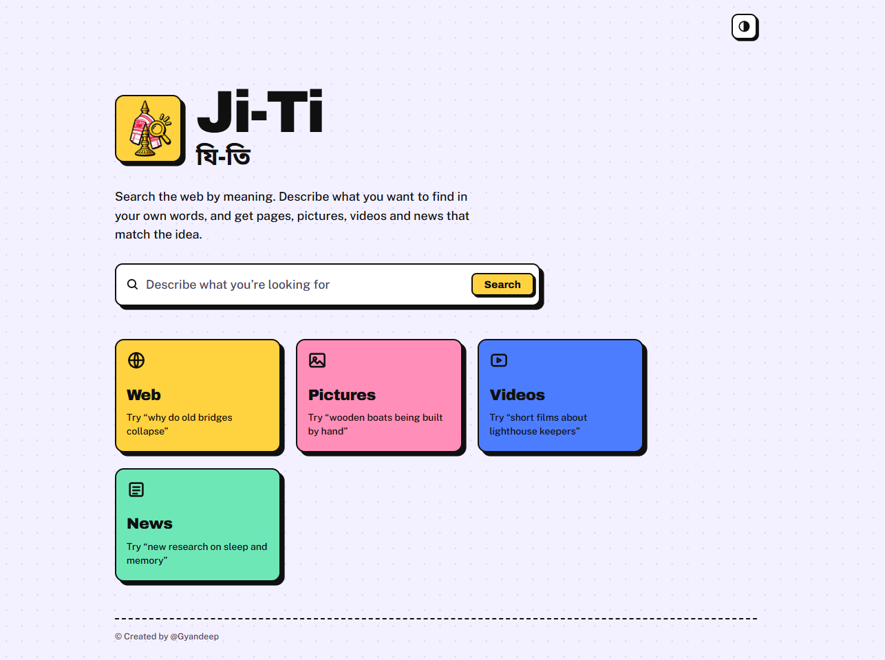
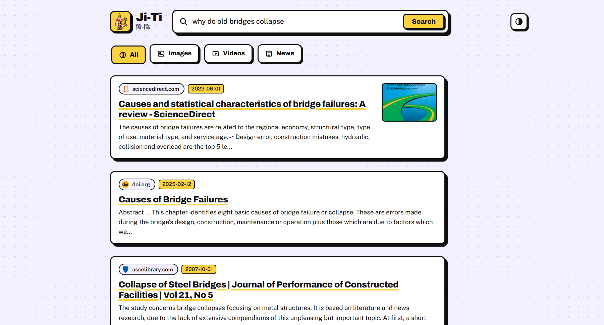
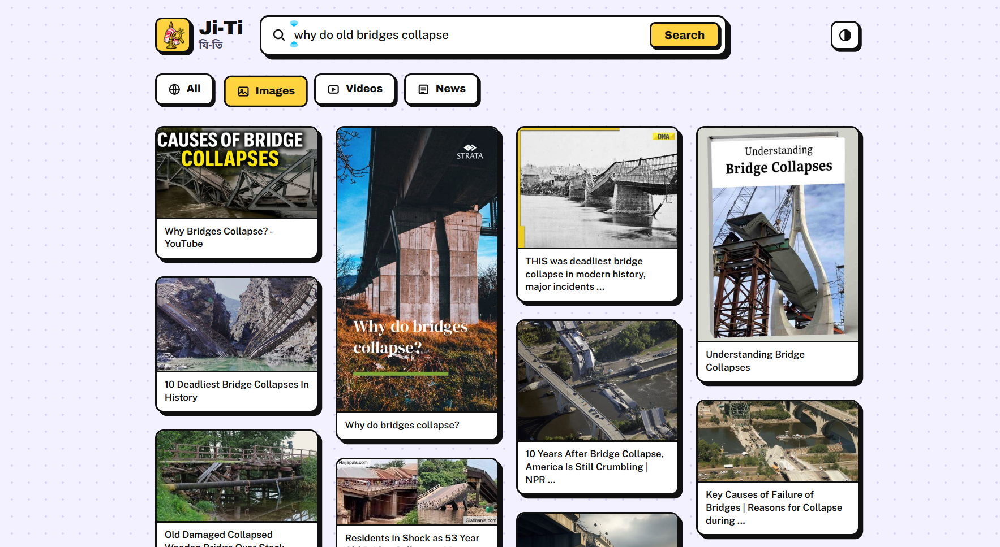

  

<h1 align="center">Ji-Ti (যি-তি)</h1>

  A small search engine that searches the web by meaning. 
  It runs on your own computer and opens in your browser.

## Features

- **All tab:** meaning-based search powered by Exa, with page numbers.
- **Images, Videos and News tabs:** free results from DuckDuckGo through the ddgs library, with a Load more button.
- Videos play inside the page.
- Neo-brutalist design, a light and dark theme, and a list of recent searches.
- Name and logo with an Assamese touch.

## Screenshots

<table>
  <tr>
    <td></td>
    <td></td>
  </tr>
</table>

## Setup (Windows)

1. Install Python 3.10 or newer.
2. Run `pip install -r requirements.txt`.
3. Copy `.env.example` to a new file named `.env` and put your Exa API key in it.
4. Run `python app.py` and open http://127.0.0.1:5000. You can also double-click `start.bat`.

## Notes

- Only the All tab uses Exa, and Exa searches use credits.
- ddgs is an unofficial library, so the free tabs can be rate-limited or stop working if DuckDuckGo changes.
- `make_favicon.py` rebuilds the browser tab icon from `static/logo.png`.

Created by Gyandeep.